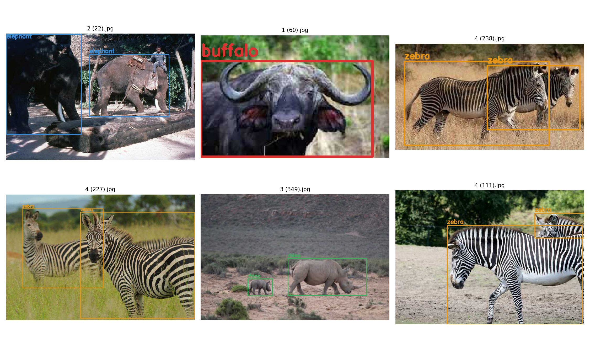
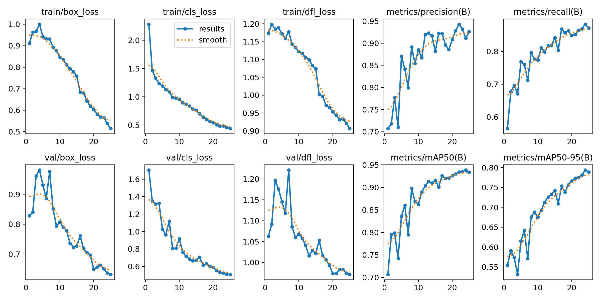
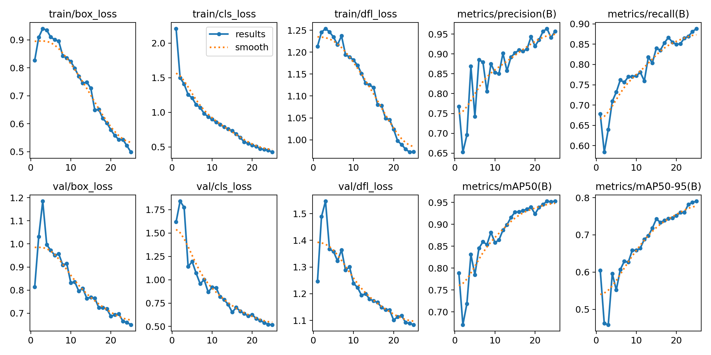
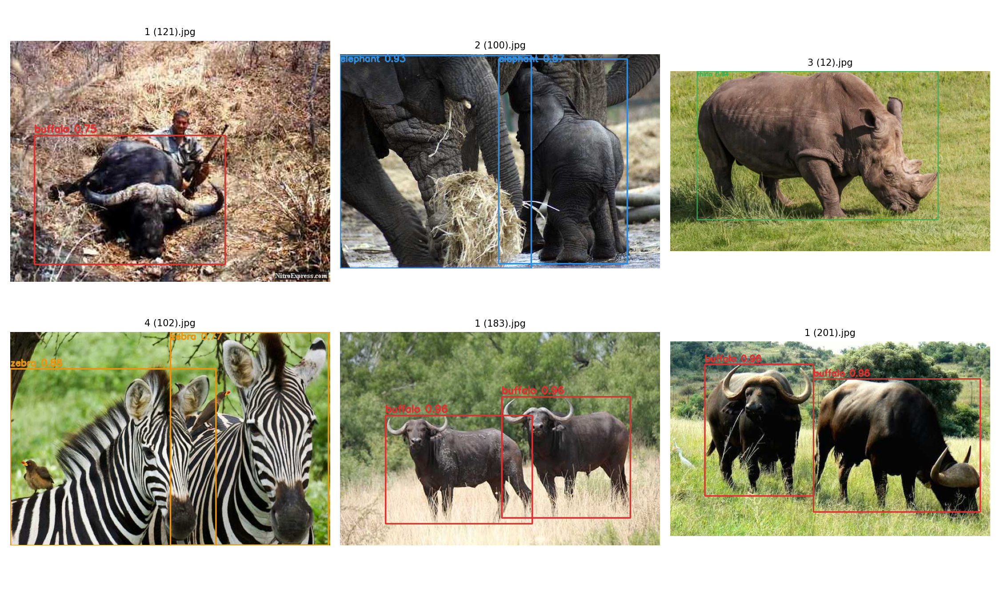
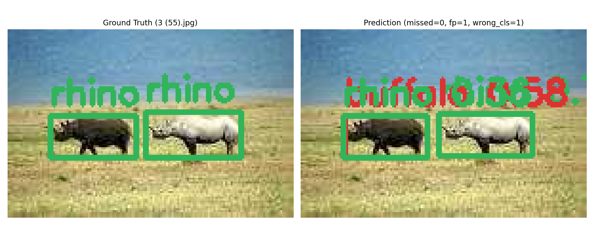
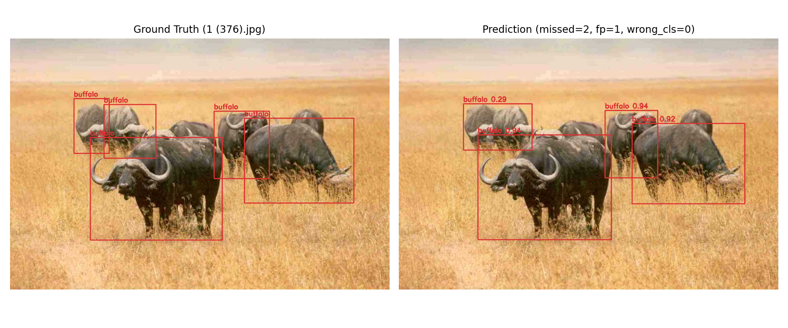
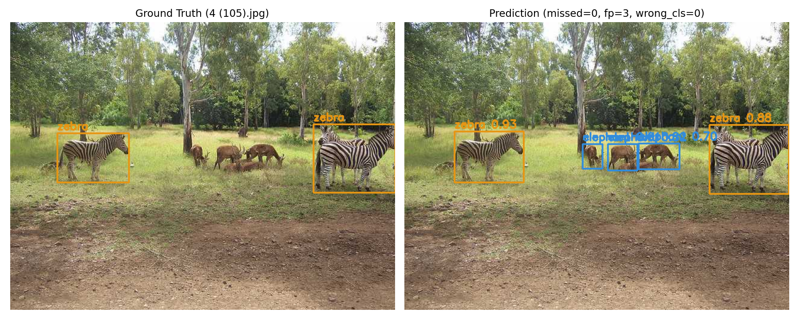

# African Wildlife Object Detector

[](https://colab.research.google.com/github/NurkhanZ/DeepLearning2026/blob/main/notebooks/train_object_detector.ipynb)

## Overview

This repository implements an object detection pipeline for the Deep Learning bonus project at KBTU 2026 class. It fine tunes a pretrained **YOLOv8n** detector on the African Wildlife dataset to detect buffalos, elephants, rhinos and zebras, runs an experiment, evaluates the best validation checkpoint on a test set and analyzes failure cases.

## 1. Setup and Run 

### Google Colab 

1. Click the **Open in Colab** badge or go to `https://colab.research.google.com/github/NurkhanZ/DeepLearning2026/blob/main/notebooks/train_object_detector.ipynb`.
2. In Colab, go to **Runtime -> Change runtime type -> T4 GPU**.
3. Run all cells in order. The notebook clones the repository, installs `requirements.txt`, downloads and cleans the dataset, trains both runs, selects the best checkpoint on validation, and evaluates on the test split.

### Locally

```bash
# Clone the repository and download all dependencies
git clone https://github.com/NurkhanZ/DeepLearning2026.git
cd DeepLearning2026
pip install -r requirements.txt

# Download, deduplicate and inspect dataset
python scripts/prepare_data.py

# Train baseline and do the experiment
python scripts/train.py --config configs/baseline.yaml
python scripts/train.py --config configs/experiment.yaml

# Evaluate the selected checkpoint on the test set
python scripts/evaluate.py --weights weights/best.pt --imgsz 640 --conf 0.25 --iou 0.50
```

## 2. Dataset

- **Dataset:** African Wildlife Object Detection Dataset
- **Source:** [Ultralytics African Wildlife Documentation](https://docs.ultralytics.com/datasets/detect/african-wildlife/)
- **License:** Distributed by Ultralytics under **GNU AGPL-3.0** (check `LICENSE.txt` in `data/african-wildlife` folder).
- **Classes:** `0: buffalo`, `1: elephant`, `2: rhino`, `3: zebra`
- **Annotation Format:** one .txt file per image with one object per line:
  ```
  <class_id> <x_center> <y_center> <width> <height>
  ```
  All bounding-box coordinates are normalized to [0, 1] relative to image width and height.

### Data Quality Analysis and Deduplication

Before training, `scripts/prepare_data.py` checks every image and label file across `train`, `val`, and `test`:

- **Check for invalid labels/images:** after running the script, there are `0` missing label files, `0` empty label files, `0` invalid class IDs or out of range bounding boxes and `0` unreadable images.
- **Duplicates removing:** Hashing image bytes showed `41` exact duplicate images, including `20` cross duplicates shared between `train`, `val`, and `test`. To prevent data leakage, exact duplicates were removed in priority order `train -> val -> test` (`16` removed from `train`, `9` from `val`, `16` from `test`).
- **Splits:** The original `train` / `val` / `test` split structure is preserved after deduplication, so reshuffling is not needed.

### Split Statistics after Deduplication

| Split | Images | Total Objects | Buffalo | Elephant | Rhino | Zebra |
| :--- | :---: | :---: | :---: | :---: | :---: | :---: |
| **Train** | 1,036 | 1,904 | 393 | 558 | 388 | 565 |
| **Validation** | 216 | 364 | 85 | 87 | 81 | 111 |
| **Test** | 211 | 352 | 63 | 96 | 69 | 124 |
| **Total** | **1,463** | **2,620** | **541** | **741** | **538** | **800** |

### Ground-Truth Sample Images

Six training images with their ground-truth bounding boxes (made with `scripts/prepare_data.py`):




## 3. Baseline Training and Experiment

### Shared Training Configuration

Both runs use the exact same cleaned dataset split, initial pretrained weights, optimizer setup, and random seed:

| Setting | Value |
| :--- | :--- |
| Framework | `ultralytics==8.3.49` (`torch==2.5.1+cu124`) |
| Hardware | NVIDIA GeForce RTX 4060 Laptop GPU (8 GB VRAM) |
| Model & Initial Weights | `yolov8n.pt` (COCO-pretrained, ~3.01M parameters) |
| Epochs | `25` |
| Batch Size | `16` |
| Initial Learning Rate  | `0.01` |
| Random Seed | `12345` (`deterministic=True`) |

### Controlled Experiment Hypothesis

- **Single intentional change:** Increase input image resolution (`imgsz`) from **`416`** (baseline) to **`640`** (experiment), keeping all other settings fixed.
- **Hypothesis:** Higher input resolution preserves finer spatial details (such as distant animals, horns, and partially occluded bodies), which should increase **Recall** and **mAP@0.50** on the validation set, at the cost of longer training time.

### Validation Comparison

| Run | Changed Setting (`imgsz`) | Val Precision | Val Recall | Val mAP@0.50 | Val mAP@0.50:0.95 | Training Time |
| :--- | :---: | :---: | :---: | :---: | :---: | :---: |
| **Baseline** | `416` | 0.9165 | 0.8798 | 0.9404 | **0.7941** | **226.6 s** (3m 47s) |
| **Experiment** | `640` | **0.9513** | **0.8891** | **0.9531** | 0.7928 | 276.4 s (4m 36s) |

### Final Trained Checkpoint

The best validation checkpoint (`experiment` run) is included directly in the repository:
- **Download checkpoint:** [weights/best.pt](weights/best.pt) (`6.0 MB`, YOLOv8n fine-tuned weights)

**Per-class Validation AP@0.50:**

| Run | Buffalo | Elephant | Rhino | Zebra |
| :--- | :---: | :---: | :---: | :---: |
| Baseline (`416`) | 0.9614 | 0.9040 | 0.9647 | 0.9314 |
| Experiment (`640`) | **0.9740** | **0.9211** | **0.9655** | **0.9516** |

### Analysis of Experiment Results

The results support the hypothesis:
1. **Recall and mAP@0.50 improved:** Raising `imgsz` from `416` to `640` increased validation Recall by **+0.0093** (`0.8798 -> 0.8891`) and validation mAP@0.50 by **+0.0127** (`0.9404 -> 0.9531`), with gains across all four classes (especially `zebra` and `elephant`).
2. **Precision also improved:** Validation Precision increased by **+0.0348** (`0.9165 -> 0.9513`), showing that higher spatial resolution helped the detector distinguish similar silhouettes and reduce false alarms.
3. **Compute cost:** Training time increased by **+49.8 s (+22.0%)** because `640x640` images contain ~2.37x more pixels than `416x416`.

Because the **Experiment (`imgsz=640`)** achieved the higher validation `mAP@0.50` (`0.9531`), its `best.pt` checkpoint was selected as the final model before touching the held-out test set.

### Learning Curves

**Baseline (`imgsz=416`):**



**Experiment (`imgsz=640`):**



## 4. Final Test Set Evaluation

The selected checkpoint (`weights/best.pt`, `imgsz=640`) was evaluated once on the held-out test set (`211` images, `352` objects).

- **Evaluation IoU threshold:** `0.50` (for Precision, Recall, and mAP@0.50)
- **Prediction visualization confidence threshold:** `0.25`
- **NMS IoU threshold:** `0.50`

### Test Metrics

| Class | Images | Objects | Precision | Recall | mAP@0.50 | mAP@0.50:0.95 |
| :--- | :---: | :---: | :---: | :---: | :---: | :---: |
| **All** | **211** | **352** | **0.9641** | **0.9388** | **0.9738** | **0.8271** |
| buffalo | 46 | 63 | 0.9670 | 0.9050 | 0.9712 | 0.8470 |
| elephant | 56 | 96 | 0.9550 | 0.9380 | 0.9629 | 0.7800 |
| rhino | 49 | 69 | 0.9690 | 0.9860 | 0.9913 | 0.8980 |
| zebra | 61 | 124 | 0.9660 | 0.9270 | 0.9699 | 0.7830 |


### Test Prediction Examples

Six test images showing predicted bounding boxes, class names, and confidence scores (`conf=0.25`, `iou=0.50`):




## 5. Failure Case Analysis

Three representative failure cases from the held-out test set (Ground Truth on the left, Model Prediction on the right):

### Case 1: Low Resolution & Overlapping Duplicate Class (`3 (55).jpg`)

- **What happened:** The darker rhino on the left was predicted as both `buffalo (0.58)` and `rhino (0.36)` on nearly the same box.
- **Likely cause:** The source image is heavily pixelated, hiding the rhino's horn and facial details so its dark silhouette resembles a buffalo. Because standard NMS is class-aware, it does not suppress overlapping boxes from different classes.

### Case 2: Merged Boxes in Overlapping Herd (`1 (376).jpg`)

- **What happened:** Two closely overlapping background buffaloes on the upper left were merged into a single low-confidence prediction (`buffalo 0.29`), causing 2 missed ground-truth matches and 1 false positive.
- **Likely cause:** Heavy overlap among distant animals causes the detector to predict one wide box covering two bodies instead of separating them.

### Case 3: Out-of-Distribution Animals (`4 (105).jpg`)

- **What happened:** While both zebras were detected accurately (`0.93`, `0.88`), three antelopes in the background were falsely predicted as `elephant` (`0.82`, `0.70`, `0.61`).
- **Likely cause:** Antelopes are not one of the four training classes, and the training set contains very few negative/background images with non-target wildlife, causing the detector to force unfamiliar quadrupeds into one of its known classes.

### Practical Next Step

To reduce these errors, the next step is to enable class-agnostic NMS (`agnostic_nms=True`) at inference (which prevents predicting both `buffalo` and `rhino` on the same animal in Case 1) and include negative background images containing non-target safari animals during training (to reduce false positives like Case 3).


## 6. Limitations and Future Work

- **Limited scope:** Only four African wildlife classes are covered; other animals or humans in safari scenes are ignored or could trigger false positives.
- **Single-model size:** `yolov8n` prioritizes speed over fine-grained separation in dense herds.
- **Future work:** Test class agnostic NMS, audit remaining near-duplicate frames using perceptual hashing, and compare `yolov8n` against `yolov8s` or longer training schedules with cosine learning rate decay and include images containing background species that are not targets to reduce false positives.


## Acknowledgments

- **Framework & Pretrained Weights:** [Ultralytics YOLOv8](https://github.com/ultralytics/ultralytics)
- **Dataset:** Ultralytics African Wildlife dataset 
